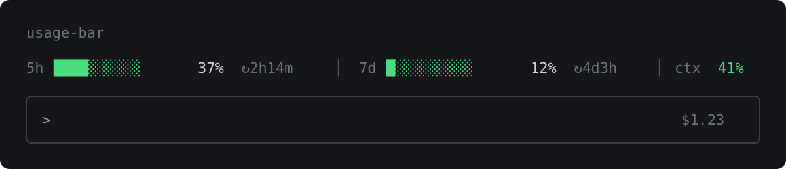

<p align="center">
  
</p>

# usage-bar for Claude Code

**A small Claude Code mod that keeps your rate limits, context fill and session cost in one line above the prompt, so you stop typing `/usage` and `/cost` to find out how much you have left.**

```
5h ████░░░░░░ 37% ↻2h14m  │  7d █░░░░░░░░░ 12% ↻4d3h  │  ctx 41%  │  $1.23
```

It reads the same numbers the status line uses, updates by itself after every turn, and draws nothing at all when there's nothing to show.

---

## What it shows

- **Rate-limit windows** (5-hour, 7-day, or a spend limit if your account has one): a bar, the percent used, and the time until it resets.
- **Context fill** for the current model.
- **Session cost** in USD.

Bars are green, turn yellow at 60% and red at 85%.

It stays out of the way:

- no data yet (before the first response, or an account that reports no limits), no band
- a survey is open, the band steps aside
- it never touches your prompt, your tools or the model's context. It only draws.

## Two versions

| | Where | Needs |
|---|---|---|
| **Band above the prompt** (this README) | the repo root, plugin `usage-bar` | Claude Code |
| **Touch Bar** | [`touchbar/`](touchbar/README.md), plugin `usage-bar-touchbar` | a Touch Bar MacBook Pro on Linux with t1bridge, GNOME |

## Who this is for

You'll get the most out of it if:

- you're on a **Claude subscription** (Pro / Max) and keep hitting the 5-hour window by surprise,
- you work in the **terminal**, where the band is drawn above the prompt (the desktop app draws the same band),
- you're on Claude Code **2.1.275 or later**, which is what the mod system needs.

It is **not** for you if:

- you use an API key only. There are no rate-limit windows to show, so you'd get context and cost and nothing else,
- you want history or graphs over days. This is a live readout of the current session, nothing more.

## Install

At the prompt of a terminal session:

```
/plugin install usage-bar --marketplace akinauphill/claude-usage-bar
```

Or from a shell:

```bash
claude plugin install usage-bar --marketplace akinauphill/claude-usage-bar
```

Claude Code asks whether to add the marketplace (`y`), then which scope. User scope turns it on for every session.

To try it from a checkout without installing:

```bash
git clone https://github.com/akinauphill/claude-usage-bar
claude --plugin-dir ./claude-usage-bar
```

## How it works

Three hooks, all in [`hooks/register.tsx`](hooks/register.tsx):

1. **`session.measure`** fires when the engine measures the session and something moved (after each turn, or when a rate-limit window gains a whole percent). The mod stores the figures.
2. **`ui.render` on `AbovePrompt`** draws the band from the stored figures. If nothing is stored yet it asks `$.session.usage()` once.
3. **`session.start`** clears the stored figures so a new session starts from a fresh reading.

The formatting (bars, colors, countdowns) is plain functions in [`hooks/format.ts`](hooks/format.ts), tested in [`hooks/format.test.ts`](hooks/format.test.ts).

## Development

```bash
claude plugin validate .
claude plugin test .
```

## Known limitations

- **Tested lightly.** It passes `claude plugin validate` and the formatting helpers have unit tests, but the band itself has no automated test and hasn't been checked on every surface (the desktop app and VS Code especially). The picture at the top is a mock-up, not a screenshot. Please open an issue if the band looks wrong somewhere.
- **The countdown is as fresh as the last measurement.** It doesn't tick on its own; it redraws when the engine reports new figures, which is after each turn.
- **Window names are whatever Claude Code reports.** `five_hour` and `seven_day` are shown as `5h` and `7d`, anything new is shown by its own name until the mod learns it.
- **Cost is an estimate.** It's the same running total `/cost` shows, not a bill.

## How this was made

**AI disclosure:** this mod was written with an AI coding assistant (Claude). It's small, but treat it as **experimental**. It isn't an official Anthropic project.

## License

MIT, see [LICENSE](LICENSE).
